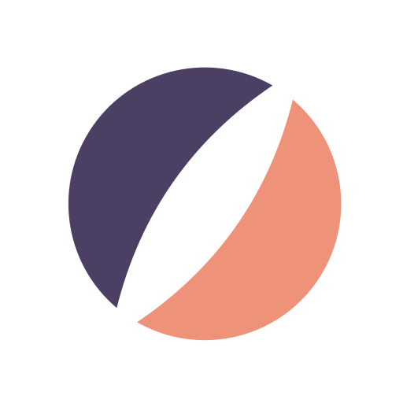

<p align="center"></p>

# LumenCoacervationEngine

凝光视效引擎为 Android View 应用提供玻璃材质、弹性手势与界面过渡。可以给已有页面的卡片、悬浮栏和弹窗添加材质，也可以统一管理整个页面的材质和动效。

## 效果与动效

| 功能 | 用途 |
| --- | --- |
| 柔光材质 `MATERIAL_YOU` | 静态环境磨砂与软件透镜，适用于 Android 8.1 及以上。 |
| 高级材质 `LIQUID` | 折射与可选实时取样。Android 12 及以上提供模糊，Android 13 及以上可用折射，按设备能力选择显示效果。 |
| 界面动效 | 长按形变、竖向滚动回弹、可打断翻页、弹窗过渡与预测返回。 |
| 控件与动画 | AppCompat 控件样式、列表拖拽排序、Lottie、PAG 与 Rive 动画接入。 |

窗口背景还可采用 Mica 或 Mica Alt 云母材质。[材质与平台兼容](docs/VISUAL_EFFECTS.md) · [云母材质](docs/MICA_MATERIAL.md)

## 下载示例

在最新 GitHub Release 的 Assets 中选择 `lumen-demo-<版本>.apk`。示例展示两套材质、列表与网格拖拽、窗口自适应及常用交互动效。[最新发布](https://github.com/Meguvizarchic/LumenCoacervationEngine/releases/latest) · [示例源码](sample/)

## 快速接入

Maven Central 上的 `1.6.2` 支持 Android 8.1 及以上（API 27），应用编译使用 Android SDK 37 或更高版本。所选的 Lumen 模块使用同一版本（`lumen-*` 不在 `meguviz-bom:1.2.0` 管理列表内；使用 `lumen-bridge-meguviz-android:1.6.2` 时再配合引入 `io.github.jichuo1.meguviz:meguviz-bom:1.2.0`）。

```kotlin
dependencies {
    implementation("io.github.jichuo1:lumen-engine:1.6.2")
}
```

> AI 编程助手接入与迁移指引见 [LumenCoacervationEngine 接入 Skill](.agents/skills/lumen-coacervation-engine/SKILL.md)。

| 按需添加的模块 | 用途 |
| --- | --- |
| `lumen-motion` | 弹性手势、翻页和弹窗过渡 |
| `lumen-controls` | AppCompat 控件样式与 RecyclerView 适配 |
| `lumen-effects` | 表面装饰、粒子和光源效果 |
| `lumen-assets` | 动画资产的读取、播放与生命周期管理 |
| `lumen-assets-lottie`、`lumen-assets-pag`、`lumen-assets-rive` | 对应动画格式的播放 |
| `lumen-compose` | Compose 局部材质和长按弹性（局部原型） |
| `lumen-bridge-meguviz-android` | 接入 MeguvizAndroid 的窗口与生命周期组件 |

只给顶栏、浮层或卡片添加材质时，可在 Activity 中创建局部会话，并在刷新时调用 `ensure`。

```kotlin
val lumen = LumenSurfaceSession.forActivity(this)
lumen.ensure(topBar, LumenSurfacePresets.floating(), source = content)
```

`topBar` 是要装饰的 View，`content` 是供取样的背景 View。需要统一接入 Activity 时，可使用 `LumenActivityDelegate` 并按指南转发生命周期和触摸回调。[局部表面用法](docs/SURFACE_SESSIONS.md) · [Activity 接入](docs/INTEGRATION_STANDARD.md)

## 文档

- [LumenCoacervationEngine 接入 Skill](.agents/skills/lumen-coacervation-engine/SKILL.md)
- [API](docs/API.md) 与 [局部视效参数](docs/VISUAL_EFFECTS.md)
- [动画资产](docs/P2_EFFECTS_AND_ASSETS.md) 与 [Compose 适用范围](docs/NATIVE_COMPOSE.md)
- [Meguviz 桥接入](docs/MEGUVIZ_BRIDGE.md) · [文档索引](docs/README.md) · [更新记录](CHANGELOG.md)
- [提交问题](https://github.com/Meguvizarchic/LumenCoacervationEngine/issues)

## 出处与许可

项目由原作者以 Apache-2.0 独立发行。来源、授权与第三方贡献见对应说明。[Bilibili Innocent Lab](https://github.com/jichuo1/Bilibili_Innocent_Lab) · [许可证](LICENSE) · [声明](NOTICE) · [第三方声明](THIRD_PARTY_NOTICES.md)
